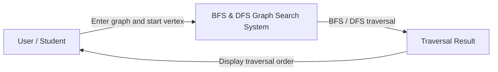
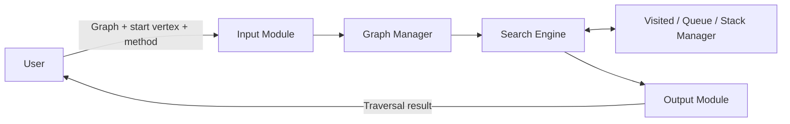
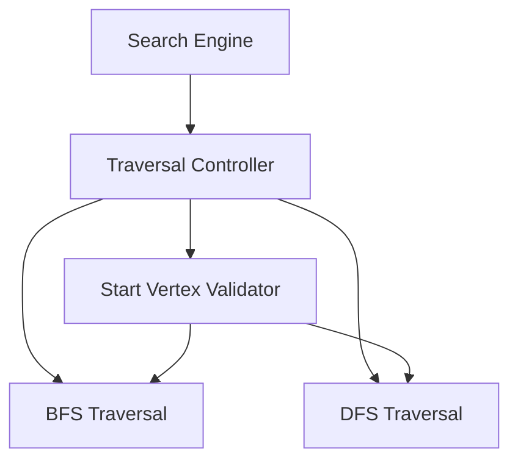

# Complete C4 Architecture Diagrams
## BFS and DFS Graph Search System
**Student:** Sanket Subhash Patil  
**Course:** 02AML204 – Introduction to Artificial Intelligence  
**SLE:** 3 – Full C4 Architecture Design  
**Language:** Python

This file combines all four C4 levels for the BFS/DFS Graph Search System in one place.

---

# Level 1 – System Context Diagram



**Explanation:** The user provides a graph, a starting vertex, and a search choice. The system runs BFS or DFS and displays the traversal order to the user.

---

# Level 2 – Container Diagram



**Container responsibilities**

| Container | Responsibility |
|---|---|
| Input Module | Accepts graph, starting vertex, and search choice. |
| Graph Manager | Stores and provides the graph adjacency representation. |
| Search Engine | Runs BFS or DFS according to the selected method. |
| Visited / Queue / Stack Manager | Tracks visited vertices and manages the data structures used during traversal. |
| Output Module | Formats and displays the traversal result. |

---

# Level 3 – Component Diagram

**Scope:** Components inside the Search Engine container.



**Component responsibilities**

| Component | Responsibility |
|---|---|
| Traversal Controller | Selects BFS or DFS and coordinates execution. |
| Start Vertex Validator | Checks that the requested starting vertex exists in the graph. |
| BFS Traversal | Performs level-wise traversal using a queue. |
| DFS Traversal | Performs depth-first traversal using recursion or a stack. |

---

# Level 4 – Code Diagram / Code-Level Overview

The code-level view maps the design to the main Python functions.

```mermaid
flowchart TD
    MAIN[main()]
    BUILD[build_graph()]
    VALIDATE[validate_start(graph, start)]
    CHOICE{Selected method}
    BFS[bfs(graph, start)]
    DFS[dfs(graph, start)]
    DISPLAY[display_result(order)]
    MAIN --> BUILD
    BUILD --> VALIDATE
    VALIDATE --> CHOICE
    CHOICE -->|BFS| BFS
    CHOICE -->|DFS| DFS
    BFS --> DISPLAY
    DFS --> DISPLAY
```

**Code element responsibilities**

| Code element | Responsibility |
|---|---|
| `main()` | Controls input, algorithm selection, and output. |
| `build_graph()` | Creates or stores the graph adjacency representation. |
| `validate_start(graph, start)` | Checks whether the starting vertex is present. |
| `bfs(graph, start)` | Performs Breadth First Search using a queue. |
| `dfs(graph, start)` | Performs Depth First Search using recursion or a stack. |
| `display_result(order)` | Displays the traversal order. |

**Code flow:** `main() → build_graph() → validate_start() → bfs()/dfs() → display_result()`

---

# Graph Used in the System

```text
A -> B, C
B -> A, D, E
C -> A, F, G
D -> B
E -> B
F -> C
G -> C
```

# Conclusion

The four C4 levels describe the same BFS/DFS system from different perspectives: the user and system boundary (Context), major runtime parts (Container), internal Search Engine components (Component), and main functions (Code). All diagrams are collected in this single Markdown file.
